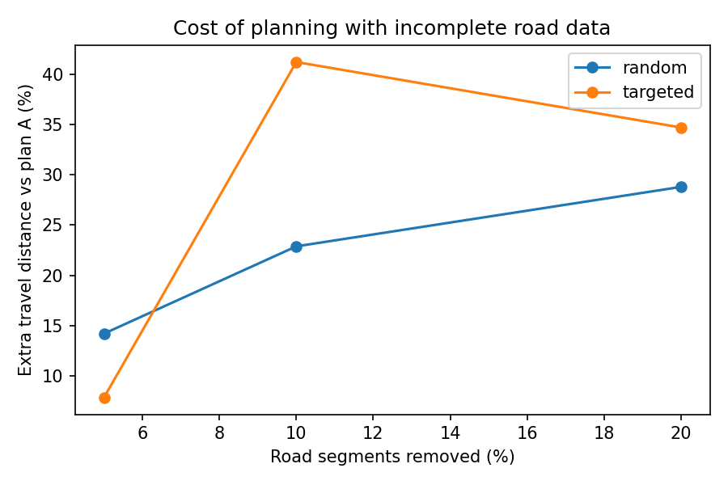

This repository holds two exploratory exercises on road-network data quality in Paradise, California. Exercise 2 is described at the bottom of this page.

# Exercise 1: Missing roads and evacuation exits: a small test in Paradise, California

A small Python exercise (OSMnx, NetworkX) testing how missing street segments change which exits look busiest and how many intersections can still reach an exit. Intersections inside the town boundary stand in for homes. See the notebook for the method, results, and limits.

This is a simplified exercise, not a replication of published models.

---

## Exercise 2: Emergency station placement under incomplete road-network data

Exploratory exercise. Not a validated evacuation model.

### Question
If a planner chooses emergency-station locations from a road network with missing segments, how much worse are those choices when judged on the full network?

### Study area and data
Paradise, California. Drivable roads from OpenStreetMap, downloaded with OSMnx on 3 November 2026. The network used (largest connected component) has 1,829 intersections and 1,994 road segments, with segment lengths in metres. Roads are treated as two-way.

### Model
A p-median facility-location problem with p = 3 stations. Demand points *i* are 150 randomly sampled intersections; candidate sites *j* are 60 randomly sampled intersections; *d_ij* is the shortest-path distance in metres.

$$\min \sum_{i}\sum_{j} d_{ij} x_{ij}$$

$$\text{subject to} \quad \sum_{j} x_{ij}=1 \text{ for every } i, \quad x_{ij}\le y_j \text{ for every } i,j, \quad \sum_{j} y_j=p, \quad y_j \in \lbrace 0,1 \rbrace, \quad 0\le x_{ij}\le 1$$

In words: choose 3 sites (*y_j* = 1) so that the total distance from every demand point to its serving station is as small as possible. Each point must be served, and only by a site that has a station. *x_ij* can stay continuous because an optimal solution assigns each point wholly to a chosen site. Solved with `scipy.optimize.milp` (HiGHS). If a demand point has no route to a site, a fixed penalty of twice the longest distance in the full network is used (23,403 m in the main sample).

### Experiment design
1. **Plan A:** best 3 stations on the full network. Total distance 307.4 km. Check: the average random 3-station plan was 453.7 km and the best of 200 random plans was 342.4 km.
2. **Incomplete networks:** 5%, 10% and 20% of road segments removed, either at random (20 repetitions per level in the main sample, 10 in the three extra samples) or the highest-ranked segments by edge betweenness (estimated from 300 sampled nodes; one scenario per level).
3. **Plan B:** best 3 stations chosen using only the incomplete network.
4. **Regret:** plan B is then evaluated on the full network. Regret (%) = 100 × (distance of plan B − distance of plan A) / distance of plan A.
5. **Robustness:** the whole experiment repeated on three further random samples of demand points and sites.

### Results

*Figure: main sample. Random removal is the mean of 20 repetitions; busiest-segment removal is one scenario per level.*

Mean regret (%), random removal:

| Sample | 5% removed | 10% removed | 20% removed |
|---|---|---|---|
| Main (20 repetitions) | 14.2 | 22.9 | 28.8 |
| Extra sample 1 | 9.3 | 14.7 | 18.2 |
| Extra sample 2 | 11.7 | 27.0 | 24.2 |
| Extra sample 3 | 10.9 | 23.6 | 23.8 |

Regret (%), busiest-segment removal (single scenario per level):

| Sample | 5% removed | 10% removed | 20% removed |
|---|---|---|---|
| Main | 7.8 | 41.2 | 34.7 |
| Extra sample 1 | 4.3 | 10.1 | 22.6 |
| Extra sample 2 | 10.6 | 30.8 | 112.4 |
| Extra sample 3 | 6.0 | 12.8 | 31.6 |

- Random removal led to a positive regret in every sample and at every level, and regret rose from 5% to 10% removal. Beyond 10% it did not rise consistently (it fell slightly in two samples). The spread between repetitions was large in the main sample (standard deviation 11 to 14 points).
- In the main sample, on average 1.7, 2.5 and 2.3 of the 3 stations changed at 5%, 10% and 20% random removal.
- In the main sample, the share of the 150 demand points with no route to any candidate site in the incomplete network averaged 10 (5%), 25 (10%) and 63 (20%) under random removal, and 9, 29 and 71 under busiest-segment removal. The network has 1,994 segments for 1,829 intersections, so it offers few alternative routes.
- Busiest-segment removal was not consistently worse than random removal: lower at 5% in all four samples, higher at 20% in all four, mixed at 10%. With one scenario per level this is only suggestive. Sample 2 at 20% (112.4%) is a single extreme case.

### Conclusion
In this exploratory exercise, planning from a network with road segments missing at random cost about 9 to 29% extra travel distance when judged on the full network, depending on the amount removed and the sample, and often moved two or more of the three stations.

### Limitations
- Randomly sampled intersections stand in for homes and stations, not actual households, population or real station sites; all demand points have equal weight.
- The network is undirected (one-way restrictions are not kept) and distance is shortest-path length, not travel time.
- The "full" network is the OpenStreetMap network on the download date. It is not ground truth and may itself be incomplete.
- "Busiest" segments are ranked by betweenness estimated from 300 sampled nodes, not by observed traffic, and are tested in one scenario per level.
- One town and four random samples; results may differ elsewhere.
- Not a validated emergency-response model and not a replication of published critical-neighborhood models.

### Reproducibility
Run in Google Colab with Python 3.13.18, numpy 2.4.6, scipy 1.16.3, osmnx 2.1.1 and networkx 3.7. Random seeds: 42 (main sample) and 1, 2, 3 (extra samples). OpenStreetMap is edited continuously, so downloading the roads later may give slightly different numbers.

### Files
`Paradise_pmedian_incomplete_network.ipynb`, `pmedian_results.csv`, `pmedian_results_other_seeds.csv`, `pmedian_regret.png`
